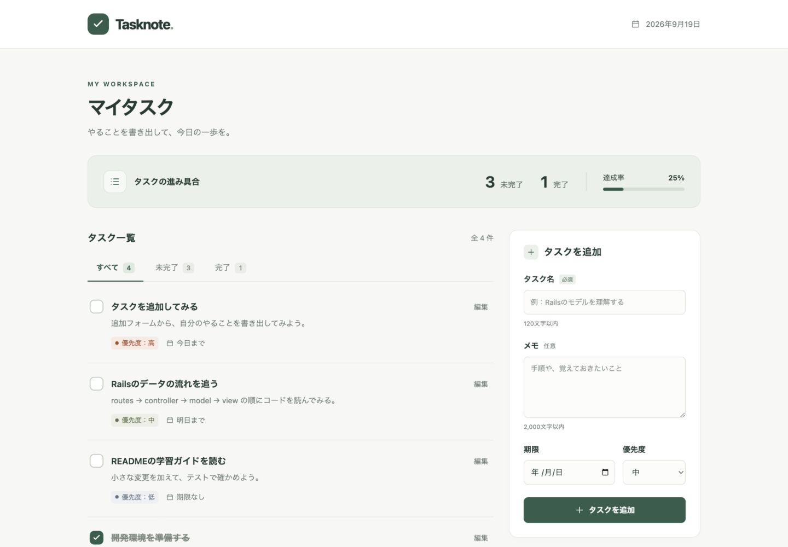

# Tasknote — Rails TodoApp

[](https://github.com/Sparklingstadt/rails-todo-app/actions/workflows/ci.yml)

転職ポートフォリオ制作の第一歩として、**動くアプリからRailsの仕組みを学ぶ**ためのTodoアプリです。

現在はローカル・1人用の初版です。ログインやユーザーごとのデータ分離はまだありません。Webサービスとして一般公開する前に認証・認可を実装します。

ソースコードは [Sparklingstadt/rails-todo-app](https://github.com/Sparklingstadt/rails-todo-app)、初回リリースは [v0.1.0](https://github.com/Sparklingstadt/rails-todo-app/releases/tag/v0.1.0) です。変更内容は [CHANGELOG](CHANGELOG.md) を参照してください。

## できること

- タスクの追加・一覧・編集・削除（削除時は確認ダイアログ）
- 完了／未完了の切り替えと絞り込み
- メモ、期限、優先度（低・中・高）
- 期限超過の表示、進捗の集計
- 日本語の入力エラー表示と入力内容の保持
- スマートフォンに対応した画面
- SQLiteへの保存（ブラウザーを閉じても残ります）



画像は `demo:seed` で学習用サンプルを追加した状態です。

## 技術構成

| 技術 | 用途・採用理由 |
| --- | --- |
| Ruby 3.4.1 / Rails 8.1.3.1 | MVC・REST・Active Recordを一つのアプリで学ぶ |
| SQLite | 別のDBサーバーを用意せず永続化を学ぶ |
| ERB / CSS | サーバーでHTMLを作る流れを追いやすくする |
| Turbo / Importmap / Stimulus | Rails標準の画面遷移基盤。Node.jsのビルドは不要 |
| Minitest / Capybara / Selenium | モデル・HTTPリクエスト・ブラウザー操作の検証 |
| RuboCop / Brakeman / bundler-audit | コードスタイルと既知の問題の検査 |
| GitHub Actions | push／PR時のテスト・スタイル検査・セキュリティ検査 |

Rails 8.1とJSON 3のAPI互換性の問題がテストで見つかったため、`Gemfile` でJSONを2系に制限しています。Railsの更新時に制限の要否を再確認します。

Rubyのバージョンは `.ruby-version`、gemのバージョンは `Gemfile.lock` に記録しています。

## 起動する

Ruby 3.4.1とBundlerを用意し、リポジトリを取得します。

```sh
git clone https://github.com/Sparklingstadt/rails-todo-app.git
cd rails-todo-app
```

このフォルダーがすでに手元にある場合は、そのフォルダーで次のコマンドを実行します。

```sh
ruby -v
bundle config set --local path vendor/bundle
bundle install
bin/rails db:prepare
bin/rails server -b 127.0.0.1
```

[http://localhost:3000](http://localhost:3000) を開きます。停止はターミナルで `Ctrl+C`。2回目以降は `bin/rails server -b 127.0.0.1` だけで起動できます。

まとめて準備する場合は `bin/setup --skip-server` も使えます。初期データは空です。

rbenvを使っていて古いmacOS標準Rubyが起動する場合は、シェルで `eval "$(rbenv init - zsh)"` を実行してから `ruby -v` と `/usr/bin/env ruby -v` がどちらも3.4.1であることを確認してください。

学習用サンプルを追加したい場合だけ、次のコマンドを実行します（既存タスクは変更しません）。

```sh
bin/rails demo:seed
```

## 検証する

```sh
bin/rails test
bin/rails test:system
bin/rubocop
bin/brakeman --no-pager
bin/bundler-audit check --update
bin/rails zeitwerk:check
```

システムテストにはGoogle Chromeが必要です。ChromeDriverはSelenium Managerが取得するため、初回はネット接続が必要です。テスト用DBは `storage/test.sqlite3` で、開発用DBとは分離しています。

`bin/ci` はセットアップ・スタイル・依存関係監査・静的解析・モデル／リクエスト／システムテストをまとめて実行します。

単体18件・HTTPリクエスト13件・E2E10件を用意しています。実行方法と確認範囲は [テストガイド](docs/testing.md)、実行結果は [検証記録](docs/verification.md) を参照してください。

## 最初に読むコード

まず画面からタスクを一つ追加し、次の順番で保存までの流れを追います。

1. `config/routes.rb` — POST /tasks がどの処理に届くか
2. `app/controllers/tasks_controller.rb` — create が入力を受け取り、保存後にどこへ戻すか
3. `app/models/task.rb` — 必須項目・文字数・期限・優先度のルール
4. `db/migrate/20260919122000_create_tasks.rb` — DBの列と制約
5. `app/views/tasks/_form.html.erb` — form_with と入力名の対応
6. `app/views/tasks/index.html.erb` / `_task.html.erb` — DBの値がどうHTMLになるか
7. `test/models/task_test.rb` / `test/controllers/tasks_controller_test.rb` — 仕様の確かめ方

詳しい解説・小さな演習・次の開発順序は [学習ガイド](docs/learning-guide.md) にまとめています。

## 設計上のポイント

- **MVCの分担**：入力ルールと検索用scopeをモデルに、リクエストと画面遷移をコントローラーに、表示をビューに配置。
- **入力検証を二重に実施**：HTMLの必須入力・最大文字数に加え、モデルでも検証。DBにもNOT NULLとCHECK制約を配置。
- **許可した項目だけ保存**：Strong Parametersで、通常編集と完了状態変更にそれぞれ必要な項目のみを許可。
- **完了操作は状態を指定**：「反転」ではなくtrue／falseを設定し、同じリクエストが2回来ても状態が戻らないようにする。
- **失敗時の使いやすさ**：不正な入力は422で元のフォームを表示し、入力済みのメモなどを保持。
- **標準の保護機構**：CSRF対策とERBのHTMLエスケープを維持。削除・更新をGETにしない。
- **日付**：Asia/Tokyoで今日を判定。過去の期限は入力可能とし、未完了の場合だけ期限超過を表示。

## データと現時点の制約

- 開発データは `storage/development.sqlite3` に保存されます。削除すると消えるため、バックアップはアプリを止めてからstorageを保管してください。
- 認証・ユーザーの所有権チェック・ページ分割は未実装。個人が手元で使う小規模な学習用です。
- ソースコードとGitHub Releaseを公開しています。Webサービスとしてのデプロイは行っていません。
- `config/master.key`・DB・ログ・インストール済みgemはGit管理対象外です。
- 本番公開時は認証・認可に加え、HTTPS、秘密情報、永続ディスク／DB、バックアップ、運用方法を決めます。

## 参照した公式資料

- [Rails Getting Started](https://guides.rubyonrails.org/getting_started.html)
- [Active Record Validations](https://guides.rubyonrails.org/active_record_validations.html)
- [Testing Rails Applications](https://guides.rubyonrails.org/testing.html)
- [Rails 8.1.3.1リリース](https://rubyonrails.org/2026/7/29/Rails-Versions-7-2-3-2-8-0-5-1-and-8-1-3-1-have-been-released)
