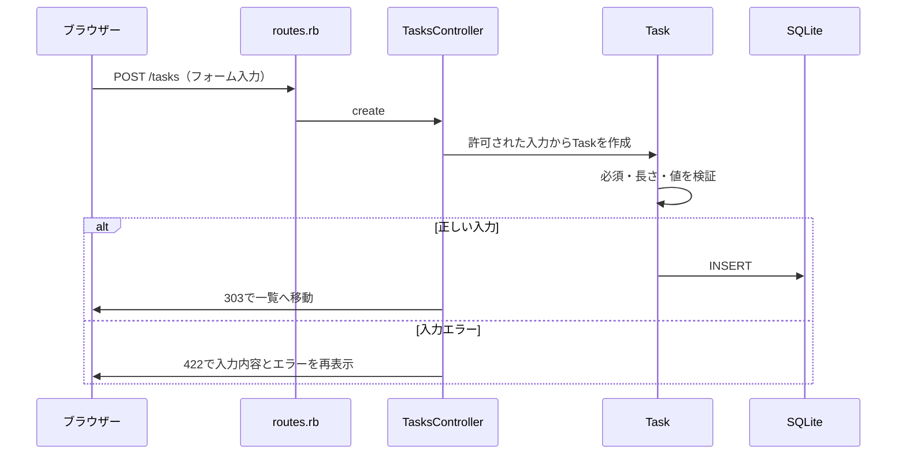

# 動く初版から学ぶRails

## まず10分で触る

1. タスク名だけ入力して追加する。
2. 編集画面でメモ・期限・優先度を変える。
3. チェックボタンで完了にして、「完了」タブで確かめる。
4. 未完了に戻し、画面を再読み込みして保存を確かめる。
5. タスク名に半角スペースだけ入れ、入力エラーとメモの保持を確かめる。
6. 削除確認で一度キャンセルし、次に削除する。

## 一つのリクエストを追う



`Model` はデータと業務ルール、`View` は表示、`Controller` はリクエストの受付と応答を担います。Railsはクラス名やファイル名の規約からそれらを結び付けます。

## 最初に理解したいRuby

- `class Task < ApplicationRecord`：TaskがActive Recordの機能を継承する。
- `def overdue?`：メソッドの定義。末尾の `?` はtrue／falseを返す意図を表す命名規約。
- `:title`：シンボル。Railsで項目名や設定名を表すときによく使う。
- `{ title: "学習する" }`：キーと値を持つHash。
- `@task`：インスタンス変数。コントローラーが設定した値をビューで参照する。
- `-> { ... }`：後で実行する処理。scopeで検索条件を定義する。
- `<%= ... %>`：ERB内のRuby式の結果をHTMLへ出力する。

## このアプリのURLと操作

| HTTP | URL | 処理 |
| --- | --- | --- |
| GET | / または /tasks | 一覧 |
| GET | /tasks/new | 追加フォーム |
| POST | /tasks | 追加 |
| GET | /tasks/:id/edit | 編集フォーム |
| PATCH | /tasks/:id | 更新 |
| PATCH | /tasks/:id/completion | 完了状態を指定 |
| DELETE | /tasks/:id | 削除 |

ブラウザーのHTMLフォームが直接使えるメソッドはGET／POSTが基本です。Railsのフォームヘルパーは `_method` を含め、RackがPATCH／DELETEとして扱えるようにします。Turboは送信とページ遷移を補助します。

実際のルーティングは `bin/rails routes` で確認できます。

## データを確認する

`bin/rails console` で対話環境を開きます。開発用DBの本物のデータを操作します。

```ruby
Task.count
Task.incomplete
Task.order(:id).last
Task.new(title: "").valid? # false
```

`exit` で終了します。`db/migrate` はDBの変更手順、`db/schema.rb` は変更後の構造です。今後の列追加は過去のmigrationを書き換えず、新しいmigrationを作ります。

## 小さく改修する練習

### 1. 文言を変える

一覧の説明文を自分の言葉に変えます。ビューの変更が画面にどう反映されるかを確認します。

### 2. 「期限が今日」のタスクを絞り込む

`Task` に検索用のscopeを追加し、コントローラーのフィルターとタブを追加します。「今日だけ表示される」リクエストテストを先に書いてから実装してください。

### 3. 文字数の仕様を変える

現在はタスク名120文字です。上限を変える場合、モデル、HTMLのmaxlength、ヒント、DBのCHECK制約、テストのすべてが同じ仕様になるよう更新します。DBは新しいmigrationで変更します。

## ポートフォリオへ育てる順番

1. **今回：基本機能** — CRUD・バリデーション・MVC・テストを説明できるようにする。
2. **ユーザー別の利用** — 認証を追加し、UserとTaskを関連付ける。他人のタスクを閲覧・変更できないことを必ずテストする。
3. **自分ならではの課題** — 例として応募企業ごとの準備タスク、学習記録、振り返りなどから一つを選ぶ。誰の何を解決するかを先に書く。
4. **公開と運用** — ホスティングとDBを選び、CI・HTTPS・秘密情報・バックアップを整える。
5. **説明資料** — 目的、利用者、画面、ER図、技術選定、工夫、テスト、残課題、デモURLをREADMEへ追記する。

Todoの機能数を増やすだけでなく、課題を決めた理由、選んだ設計、その検証結果を自分の言葉で説明できる状態を目指します。この初版はAIと共同作成した出発点なので、理解・改修・検証した範囲を正確に説明してください。

## 自分の言葉で説明するチェック

- 入力したタスク名はどのファイルを通ってDBに保存されるか。
- HTMLにrequiredがあってもモデルのバリデーションが必要なのはなぜか。
- `params.expect` は何を制限し、ユーザー認可とはどう違うか。
- 完了状態を単純に反転せず、値を指定しているのはなぜか。
- 正常な送信では303、入力エラーでは422を返すのはなぜか。
- ログイン機能を足すだけでは、他人のタスクへのアクセスを防げないのはなぜか。

[公式Railsガイド](https://guides.rubyonrails.org/getting_started.html)と、このアプリの実際のコードを往復して読むと理解を確かめられます。
